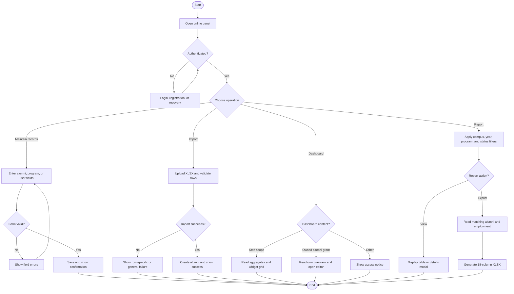

# Alumni-Tracer data and process modeling

Updated 2026-11-05. This models the current source and connected schema. [E] means implemented in source, [D] means stored data without the full intended workflow, and [P] means proposed work. An implemented flow may still lack browser, live-integration, or policy verification. Field definitions are in [data dictionary.md](data%20dictionary.md); task evidence is in [TASK_TRACKER](docs/implementation/TASK_TRACKER.md).

## Context and boundaries

One Laravel 13 application uses Filament 5 and Livewire 4 with MariaDB. The current Filament panel ID and path are both online at /online. The shared Dashboard chooses a staff widget grid or an alumni information form according to current allocation and page/action checks. /admin and /alumni are required targets in the project instructions, but neither route is implemented. Registration, Google OAuth routes, passkey routes, password recovery and MFA exist; external-provider/browser acceptance is not established here.

~~~mermaid
flowchart LR
    U[Account holder] -->|Login, profile, history, filters, XLSX| A[Laravel and Filament online panel]
    A -->|Pages, validation, downloads, feedback| U
    A <--> DB[(MariaDB)]
    A <--> G[Google OAuth, when configured]
    A --> M[Configured mail transport]
    A --> X[XLSX download]
~~~

The system stores personal contact, academic, employment and authentication data. Database access and exports therefore require authorization and minimization; current source-level grants are not a complete security certification.

## Level 0 data flow

~~~mermaid
flowchart LR
    U[Signed-in account]
    Auth([1 Account access])
    Admin([2 Manage catalogs, roles, allocations and users])
    Form([3 Owned alumni information form])
    Registry([4 Staff alumni directory and flat XLSX import])
    Report([5 Dashboard, report and XLSX export])
    D1[(Users, roles, allocations, sessions and credentials)]
    D2[(Campuses, programs and alumni)]
    D3[(Education and employment)]
    D4[(Widget layouts and settings)]
    U --> Auth
    Auth <--> D1
    U --> Admin
    Admin <--> D1
    Admin <--> D2
    U --> Form
    Form <--> D1
    Form <--> D2
    Form <--> D3
    U --> Registry
    Registry <--> D2
    U --> Report
    Report --> D2
    Report --> D3
    Report <--> D4
    Report -->|Rows, charts or XLSX| U
~~~

| Store | Current tables | Purpose |
| --- | --- | --- |
| D1 | users, roles, user_allocations, campus_user_allocations, program_user_allocations, sessions, password_reset_tokens, passkeys, trusted_devices | Accounts, grants, scoped allocation references and authenticators |
| D2 | campuses, programs, alumnis | Campus/program catalog and alumni registry |
| D3 | alumni_education, alumni_employments | Multiple study and work entries per alumnus |
| D4 | widget_grid_layouts, widget_grid_templates, widget_grid_settings | Saved dashboard layout state for a panel |
| Infrastructure | cache, cache_locks, jobs, job_batches, failed_jobs, migrations | Framework storage and queue bookkeeping |

## Current process flows

### Shared alumni information form [E, acceptance incomplete]

1. A signed-in account without an allocation reaches a safe Dashboard notice at /online. An allocated account needs the Dashboard page grant to reach the page. Dashboard displays the form only when the account has an active my_records allocation, active role, Alumni page grant, and a relevant action grant.
2. AlumniInformationForm resolves the record through alumnis.user_id. It refuses multiple owned rows or an archived owned row. Student number or email similarity never silently transfers ownership.
3. On first submission, the account supplies identity, contact and academic fields. Existing identity, program and graduation fields are read-only in this form. The account may edit contact details, reported employment status and owned education/employment entries.
4. Save rechecks access, locks the user and owned rows, validates the submitted form, rejects foreign or archived history IDs, and writes the registry and child rows in one transaction. Omitting a saved history row does not delete it. A match against another active or archived alumni row requires administrator review.
5. The form displays its saved overview. Core profile completion is a binary 0%/100% measure of eight required identity, contact and academic fields. Current/past jobs and education are displayed separately; neither changes that percentage or establishes verification. The existing editor opens on the same page. Browser behavior and the broader admission/account-link policy remain unverified or pending as recorded in the tracker.

The education table requires an end date. An ongoing study without a known end date cannot be entered through this form. Employment supporting documents are text references, not uploaded files. No history-verification or trace-event record is written.

### Staff records, allocation and import [E with limits]

Filament resources provide campus, program, alumni, role, allocation and user screens. The current RoleBasedAccessControl trait uses page/action/widget grants and allocation scopes; it does not prove every direct action and query is fully scoped. Staff alumni forms edit current registry and tracing fields. The flat AlumniImporter validates spreadsheet rows, resolves active programs by name and creates alumni rows; it has no staged preview, conflict ledger or history import. Its construction does not populate the now-required alumnis.user_id, so successful live import against this schema is not established. The original legacy workbook remains unavailable for inspection.

### Reporting, dashboard and export [E, acceptance incomplete]

The report reads non-deleted alumni with campus, graduation calendar year, department/program and employment-status filters; its details modal reads related histories. The XLSX export accepts those four filter values, groups by campus/program, and writes a title plus 18 data columns. It selects a current employment entry when available, otherwise the most recent entry. Table search, sort, page and selected rows do not define export scope. Campus-filtered source tests passed, while browser acceptance and broader export authorization/scope remain open in the tracker. Dashboard widgets are derived from stored records, not separate facts.

## 3. System flowchart

The original operation flow and ASCII drawing are restored here, with labels updated for the current `/online` Dashboard and four report filters.



### ASCII drawing

```text
[Open online] -> {Authenticated?} -- No --> [Login / register / recover]
                       | Yes
                       v
                {Choose operation}
                  | Maintain -> [Validate form] -> [Save / field errors]
                  | Import -> [Validate XLSX] -> [Create / failure]
                  | Dashboard -> [Staff widgets / own overview / access notice]
                  + Report -> [Campus / year / program / status filters]
                                | View -> [Table / details]
                                + Export -> [Alumni + employment] -> [18-column XLSX]
```

The import branch shows the intended response path. Successful connected-database import is unverified because the current importer does not supply required `alumnis.user_id`. The alumni editor's ownership, validation, duplicate-match and transaction checks are detailed in the shared-form process above.

## Data and control rules

- The registry column graduation_year stores an exact date. Department in the report is a Program; there is no department table.
- Nullable employment_status and untraced are separate from unemployed. Employment rows and education rows can overlap; neither automatically verifies the other.
- Alumni and catalog models use soft deletion. Education/employment models do not apply SoftDeletes despite having deleted_at columns; the shared form filters those rows explicitly.
- alumnis.user_id is required and is the form's ownership key, but is not unique. Form-level ambiguity checks do not replace a future reviewed database constraint.
- Physical FK deletion can cascade from users, programs and alumni to dependent data. No deletion or migration is performed by this documentation change.
- Stored role/access JSON and allocation links are current. The approved institution-wide role policy, account claim, retention and export scope remain separate decisions.

## Planned process extensions [P]

The target design calls for controlled /admin and /alumni routing, approved identity linking, verified tracing events, survey definitions/assignments/responses, approved queued survey delivery, staged legacy import, and audited scoped exports. These tables and workflows are absent from the current schema. See [requirements](docs/requirements/REQUIREMENTS.md), [database design](docs/architecture/DATABASE_DESIGN.md), and [implementation plan](docs/implementation/IMPLEMENTATION_PLAN.md); proposed behavior is not shown as a current data flow.
