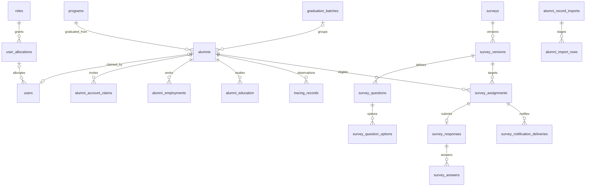

# Alumni-Tracer database design

Date: 2026-10-31. **Proposed forward-only design; no migration execution authorized by this document.** Reuse existing names and bigint primary keys. Add UUID identity where needed without rewriting PK/FKs. All new IDs below are unsigned bigint unless specified; timestamps are UTC, dates remain date-only. Effective connected DB: MariaDB 12.3.2 / REPEATABLE-READ / session timezone SYSTEM. Production engine/version, scale, topology and backup/restore readiness remain UNVERIFIED.

## Current model and integrity

**2026-11-07 owner-approved compatibility update:** staff may create admin-managed Alumni registry rows without a linked account. A forward migration makes `alumnis.user_id` nullable while retaining its foreign key to `users.id`; existing links remain unchanged. `NULL` means no account is linked and therefore no alumni self-service ownership. Staff may explicitly link an unlinked record through the Alumni table after reviewing active User candidates matched by normalized email or exact student ID. The action rechecks the reference and record scope under row locks, and refuses an account already linked to any Alumni row (including archived rows). No ID/email auto-link is allowed, and a link does not change RBAC. Rollback refuses to restore `NOT NULL` while unlinked rows exist. The prior 2026-11-04 connected schema observation (`user_id` required) describes the pre-migration schema; the migration has not been run against the configured MariaDB. `User::alumnis()` remains a HasMany relationship. The history tables use `alumni_id`; education retains `instituion` and required `ended_at`, and employment requires a text `supported_documents` reference. The earlier proposed inverse `users.alumni_id` link is not used.

Same-account form saves serialize on the user row. Cross-account Student ID/email duplication still lacks a database unique constraint, so concurrent duplicate creation across different accounts remains a limitation requiring reviewed future schema work. No institution-wide uniqueness scope or backfill policy is inferred here.

At the earlier audit baseline, `roles -> user_allocations -> users` was independent of `programs -> alumnis -> {alumni_employments, alumni_education}` and no user/alumni link existed. The 2026-11-04 metadata above supersedes that linkage description. Current Role and UserAllocation models also apply SoftDeletes; history models still do not, so the form explicitly filters their `deleted_at`. `users.email`, `roles.name`, `user_allocations.code` are unique. Student number, Google subject and program name are not unique. Program/alumni physical deletion cascades into historical data. The root [existing ERD](../../entity-relationship-diagram.md) and earlier audit remain historical references and may lag newer source.

There are 17 project-defined tables plus Laravel migrations bookkeeping. Framework queue/cache/session and three widget-grid tables are reused. No passkeys/survey/claims/audit/import-ledger/notifications table was present in the connected schema.

## Proposed entity model

Registry may have no account; an alumni account has exactly one link, while staff may have none. Shared staff/alumni dual roles require school approval; do not infer them.

## Extend existing tables

| Table | Proposed columns / contract | Constraints and indexes |
| --- | --- | --- |
| `users` | nullable `alumni_id`; `activated_at`, `disabled_at`; retain existing email/password/MFA/allocation fields | Unique alumni_id + FK RESTRICT; email uniqueness includes archived accounts; Google subject unique after cleanup; staff admission needs explicit allocation |
| `roles` | Reuse `action` JSON as flat permission-key list; casts and SoftDeletes, add relationships | Unique existing name; malformed/null grant list denies; page/subpage/widget JSON cannot confer broader grants |
| `user_allocations` | Reuse role/code/scope and relationships; make `max_users` nullable with NULL explicitly meaning no seat cap for the provisioned self-scoped Alumni allocation | Do not treat code as public activation secret. Finite staff caps still enforced under allocation lock. Alumni allocation carries only own-record grants, never admin.access; deleted allocation/role denies both portals |
| `alumnis` | Add `uuid`, temporary `student_number_text`, nullable `graduation_batch_id`, `graduation_date`, `verification_status`, contact verification metadata, `record_source`, `created_by`, `updated_by`, `verified_by`, `verified_at` | UUID unique; student text unique only after DEC-04 scope/duplicate review; batch/program FKs RESTRICT; indexes `(program_id, graduation_batch_id, deleted_at)` and status/trace predicates only after query plans |
| `alumnis` legacy fields | Middle name/email/phone/address and legacy full-date `graduation_year` become nullable during compatibility; new batch/year context carries year-only facts; separate tracing and employment dimensions introduced with documented backfill | Adapt all readers, option builders, forms and exports to nullable legacy dates before writing sparse records. Never synthesize exact date from year. No DOB or extra sensitive identity attributes without demonstrated need |
| `programs` | Keep existing table; optional stable code only if school supplies codes | No guessed name merges; RESTRICT physical deletion; retain historical relation with archived program |
| `alumni_employments` | Keep employer/classification/current/date fields; allow absent legacy address/hire/evidence and nullable `employment_type`/`is_current` when classification/currentness is unknown; add `source`, `reported_by`, `verified_by`, `verification_status`, `verified_at`, `last_confirmed_at`, actor metadata | FK RESTRICT; `(alumni_id, deleted_at, is_current)`; end >= start when both known; unknown currentness is neither true nor false; no global unique-current constraint because concurrent jobs allowed |
| `alumni_education` | Keep `instituion` spelling for compatibility; nullable units/date endpoints/evidence, source/reviewer metadata | FK RESTRICT; `(alumni_id, deleted_at, status)`; completion >= enrollment when known; rename spelling only through later compatible migration |

All verification statuses have a closed allowed set (`unverified`, `pending`, `verified`, `rejected`), validated server-side and constrained where supported. Exact workflow transitions are approved before use. New source statuses do not automatically reinterpret existing remarks as school verification. Status history and immutable submitted payloads remain available to reviewers.

## New tables, created only when the owning task is eligible

| Table | Essential columns | Integrity / query indexes |
| --- | --- | --- |
| `graduation_batches` | id, year (small integer), label, created_at/updated_at | Unique year+label; nullable alumni FK allows unknown batch; no default batch 2022 |
| `alumni_staff_assignments` | user_id, alumni_id, assigned_by, timestamps | Unique pair, FKs RESTRICT; only needed for approved record-level tracer scope; query by user_id then alumni_id |
| `alumni_account_claims` | alumni_id, token_hash char(64), approved_email, approved_by/at, issued_by/at, expires_at, consumed_at, revoked_at, claimed_user_id, verification_method | Unique digest; indexes `(alumni_id, consumed_at, revoked_at)`, expiry; lock registry before claim; no plaintext token; invite snapshots approved contact |
| `tracing_records` | alumni_id, occurred_at, actor_id nullable, legacy_tracer nullable, source, tracing_outcome, reported_employment_status, remarks, reviewer fields, import_row_id nullable | `(alumni_id, occurred_at, id)` for history; occurred_at/reporting scope index as measured; RESTRICT alumni; imported name not guessed user FK |
| `surveys` | title, description, instructions, status, current_version_id nullable, created_by, published_by/at, timestamps | Current version must belong to survey, checked transactionally; draft/published/closed controlled transitions |
| `survey_versions` | survey_id, number, definition_hash, opens_at, closes_at, targeting_snapshot JSON, published_at, created_by | Unique `(survey_id, number)`; published immutable; close > open; audience/definition revision checked before approval |
| `survey_questions` | version_id, key, type, prompt, required, position, validation JSON | Unique `(version_id, key)`; index `(version_id, position)`; validation JSON typed/allow-listed, not executable rules from client |
| `survey_question_options` | question_id, key, label, position | Unique `(question_id, key)`; immutable with published version; option references checked within question |
| `survey_assignments` | version_id, alumni_id, assigned_at, withdrawn_at, withdrawal_reason | Unique `(version_id, alumni_id)`; `(alumni_id, withdrawn_at, version_id)` for portal; historic rows retained on withdrawal |
| `survey_responses` | assignment_id, respondent_user_id, submitted_at | Unique assignment_id; FK RESTRICT; user account bound to assignment alumni at submission |
| `survey_answers` | response_id, question_id, value JSON | Unique `(response_id, question_id)`; bounded typed scalar/array; server ensures question/version and options agree with response assignment |
| `survey_notification_deliveries` | assignment_id, kind, sequence, status, attempts, scheduled_at, claimed_at, accepted_at, delivered_at, failed_at, safe_error_code, provider_message_id | AT-V01 creates schema and held `awaiting_approval` intent; AT-N01 releases only approved eligible work. Unique `(assignment_id, kind, sequence)`; `(status, scheduled_at, id)` for dispatcher; ambiguous state retained, no exactly-once email guarantee |
| `alumni_record_imports` | uploader_id, file_hash, private_path, parser/mapping_version, source_metadata JSON, state, preview_revision, approved_by/at, applied_at, counts JSON | `(state, created_at, id)` for admin queue; hash identifies upload, not automatic approval/dedupe of all future legitimate imports |
| `alumni_import_rows` | import_id, sheet_index, row_number, row_hash, encrypted raw/normalized payload, program context, validation_codes JSON, resolution, matched_alumni_id nullable, applied_at | Unique `(import_id, sheet_index, row_number)`; `(import_id, resolution, id)`; private payload retention; no plaintext staged PII in generic logs |
| `audit_logs` | actor_id nullable, action code, entity_type/id, occurred_at, correlation_id, allow-listed metadata JSON | `(entity_type, entity_id, occurred_at, id)` and `(actor_id, occurred_at, id)`; immutable application writes; no raw tokens/contacts/answers |
| `notifications` | Native Laravel database-notification structure when portal inbox is built | Native unread/user indexes; payload uses safe labels/internal links, not sensitive answer copies |

New business tables include created/updated timestamps where mutable; append-only audit/response histories use occurrence/submission timestamps. UUID added to alumni is an identity requirement, not a substitute for authorization. Bigint internal references remain private, with routes scoped regardless of identifier form.

## Constraints, concurrency and failure contracts

- Claim: resolve preprovisioned self-scoped Alumni allocation; lock allocation, `alumnis`, then claim; validate active role/grants, eligibility, approval and unused/unexpired token; create user with that allocation/link, consume claim and audit in one transaction. No public role selection or implicit roleless alumni exception. Unique user.alumni_id and token digest protect races. Reissue serializes on the registry lock, revokes old claims and never takes allocation locks out of order. Soft-deleting a user does not free its link for public re-claim.
- Publish: lock survey/version; create immutable version, unique assignments and delivery intent atomically. A pending delivery row is durable work; post-commit dispatch can be recovered. Consistent lock ordering avoids submission/closure deadlocks.
- Submit: lock survey/version then assignment; recheck times/withdrawal; unique response insert with all answers; rollback on invalid answer or conflict. Repeated requests return a defined already-submitted response, never partial answers. Draft autosave is outside initial scope.
- Employment review: lock alumnus, apply reviewed record transition, trace and audit together. No blind derived registry status overwrite. Multiple current employers remain supported.
- Import apply: lock import header, verify approved preview/file/mapping revision, process bounded row transactions; re-resolve matches under stable text unique constraint. Mark applied row atomically with its writes. Resume skips committed rows; failed/ambiguous rows remain reviewable. Never hold a DB transaction while parsing a workbook or fetching/sending files/mail.
- Where cross-table invariants cannot be expressed by a simple FK (answer version, current version ownership), enforce them within these actions and test malicious cross-reference inputs. Application validation complements, rather than replaces, critical single-table uniqueness.
- Deadlocks/uniqueness collisions use bounded retry or generic conflict outcomes. Verify actual MariaDB parallel sessions on a disposable approved target; in-memory SQLite success is not a concurrency claim.

## Representative query shapes

Portal profile: User belongsTo Alumni; histories use `WHERE alumni_id = authenticated_link AND deleted_at IS NULL ORDER BY date_hired DESC, id DESC`. Survey inbox: assignment by alumni_id, joined to published version within open interval, left-check response; cursor paginate on stable IDs. Reporting: scope non-deleted alumni by permitted programs/batches, use EXISTS for employment/education membership rather than joined row counts; count unique alumni. Delivery recovery uses status+scheduled_at+id. Import review uses import_id+resolution+id. Staff resource scopes precede filter/search/export. Add indexes only after EXPLAIN confirms benefit; no workload benchmark is claimed.

## Expand, reconcile, switch, contract

1. Confirm target and backups/restore rehearsal, inventory actual duplicates/NULLs/date certainty without exporting PII, approve uniqueness/deletion policies, check table size/locking budget.
2. Add nullable new fields/tables and indexes in new migrations. Do not alter historical migrations. Schema changes may lock/rebuild MariaDB tables; inspect exact engine/DDL plan on a copy before execution.
3. Backfill bounded resumable batches with checkpoints. Integer-to-text preserves current digits only; it cannot recover lost zero prefixes. Derive year only where supported; retain date/source certainty and review conflicting records. Do not auto-link users by email/student ID.
4. Deploy compatible readers/writers and preview-only tooling. Validate duplicate-resolution and nullability before adding unique/NOT NULL constraints; no implicit duplicate deletion. Rehearse foreign-key RESTRICT changes and disabled force-delete UI.
5. Switch source-of-truth reads/writes explicitly, verify report/import/API compatibility and invariants, monitor errors. Old clients must still receive defined behavior or be migrated in the same release.
6. Retain old columns through an approved rollback window. Dropping legacy columns/tables or erasing source artifacts requires separate explicit approval and retention policy. Roll back application code to compatible additive schema; never roll back by dropping newly collected histories/answers.

Physical deletion of registry, programs, submissions and histories is restricted. Soft deletion is not a retention policy. Actor account deletion retains accountable actor references or approved pseudonymous attribution; no cascading removal of evidence. Private uploads/evidence and staged import payloads have DPO-approved expiry and authorized download checks. No retention sweeper runs before that policy is supplied.
