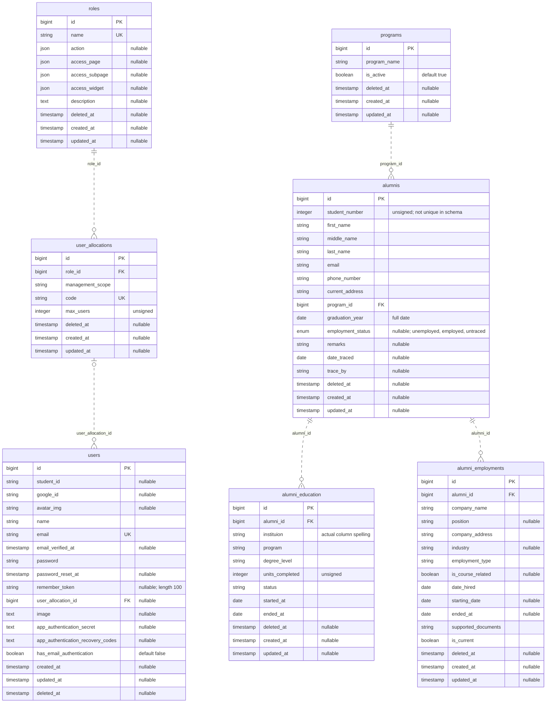
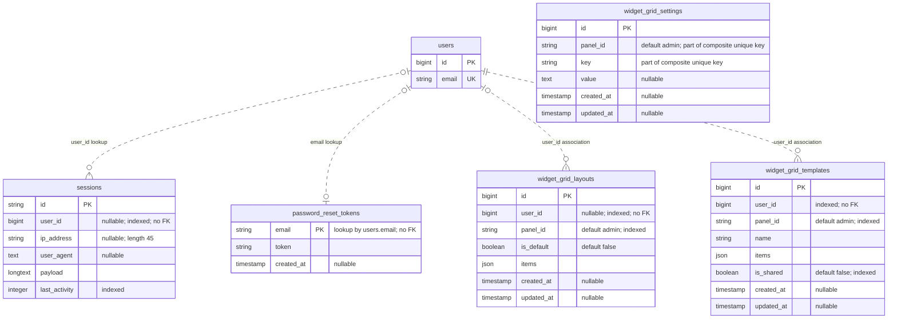
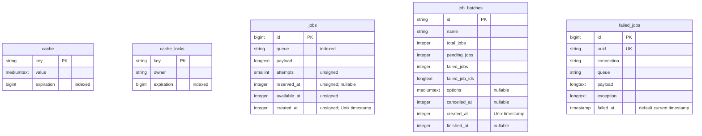

# Alumni Tracer - Entity Relationship Diagram

## Scope and sources

This ERD describes the current schema defined by the repository's 10 migrations
in [database/migrations](database/migrations), covering 17 tables. Relationships
were checked against [app/Models](app/Models), authentication configuration, and
the installed widget-grid package's models. This is a source-code scan, not an
inspection of a deployed database; applied migrations and database drift are
outside its scope.

The diagrams preserve actual table and column names. They separate the core
data model, authentication/dashboard support, and framework infrastructure for
readability. View this file in a Markdown viewer that supports Mermaid.

## Notation

| Notation | Meaning |
| --- | --- |
| `PK` | Primary key |
| `FK` | Foreign key enforced by a migration constraint |
| `UK` | Single-column unique constraint |
| `||` | Exactly one |
| `o|` or `|o` | Zero or one |
| `o{` or `}o` | Zero or many |
| `..` | Non-identifying relationship: the child has its own primary key |
| `"nullable"` | The column permits SQL `NULL` |

Types follow the migrations rather than a particular database engine.
`bigint` IDs and constrained IDs are unsigned; `integer` columns explicitly
marked `unsigned` are unsigned as well. Unqualified `string` columns have the
default length of 255. `created_at` and `updated_at` generated by `timestamps()`
are nullable timestamps. A `deleted_at` column is also nullable.

## 1. Core ERD

Every relationship in this diagram has an explicit database foreign key.
The account/access branch and alumni branch are separate: there is currently
no User-to-Alumni foreign key or Eloquent relationship.

### Entity responsibilities

| Table | Responsibility |
| --- | --- |
| `roles` | Role names and JSON action/page/subpage/widget permissions; storage exists, enforcement remains planned. |
| `user_allocations` | Role-linked allocation codes, management scopes, and configured user limits. |
| `users` | Login accounts, Google identity fields, MFA settings, and optional allocation assignment. |
| `programs` | Academic programs and their active/inactive status; report "Department" refers to a program. |
| `alumnis` | Alumni identity/contact data, program, graduation date, employment status, and manual tracing fields. |
| `alumni_education` | Education-history entries belonging to an alumnus. |
| `alumni_employments` | Employment-history entries belonging to an alumnus. |

### Foreign keys and deletion rules

| Parent | Child foreign key | Cardinality | On physical parent deletion |
| --- | --- | --- | --- |
| `roles.id` | `user_allocations.role_id` | One role to zero or many allocations; each allocation requires one role. | No cascade specified; referenced roles cannot be deleted while allocations remain. |
| `user_allocations.id` | `users.user_allocation_id` | One allocation to zero or many users; each user has zero or one allocation. | Set the user's allocation ID to `NULL`. |
| `programs.id` | `alumnis.program_id` | One program to zero or many alumni; each alumnus requires one program. | Cascade deletion to related alumni. |
| `alumnis.id` | `alumni_education.alumni_id` | One alumnus to zero or many education entries; each entry requires one alumnus. | Cascade deletion to related education entries. |
| `alumnis.id` | `alumni_employments.alumni_id` | One alumnus to zero or many employment entries; each entry requires one alumnus. | Cascade deletion to related employment entries. |

Database deletion actions apply to physical deletion, not setting `deleted_at`.
Physically deleting a program can therefore cascade through alumni to both
history tables.

## 2. Authentication and dashboard support

The relationships below are **application associations without database foreign
key constraints**. Cardinalities describe intended associations to existing
users; the schema does not prevent orphaned user IDs or password-reset emails.
The `users` entity is repeated with selected fields; its complete definition is
in the core ERD.

| Table | Responsibility and constraints |
| --- | --- |
| `sessions` | Database-backed sessions; a guest session may have no user. `user_id` is indexed but not constrained. |
| `password_reset_tokens` | At most one reset-token row per email because `email` is the primary key. Laravel resolves the account by email. |
| `widget_grid_layouts` | Personal/default dashboard layouts; `user_id` is nullable. A non-unique composite index covers `(user_id, panel_id, is_default)`. |
| `widget_grid_templates` | Named user-owned dashboard templates, optionally shared. The package defines a `user()` relationship. |
| `widget_grid_settings` | Panel-specific key/value settings. `(panel_id, key)` is a composite unique constraint. There is no separate panels table. |

The widget package also defines `WidgetGridLayout::user()`. The migration
defaults `panel_id` to `admin`, while the application configures the widget-grid
plugin for the `online` panel. These values are strings, not foreign keys.

## 3. Cache and queue infrastructure

These five migration-defined tables have no declared foreign keys or direct
relationships to the alumni domain. Their payloads and batch identifiers are
framework-managed values, not relational links defined by these migrations.

| Table | Responsibility |
| --- | --- |
| `cache` | Cached values keyed by string, with expiration times. |
| `cache_locks` | Locks keyed by string, with owners and expiration times. A lock key is not a foreign key to `cache.key`. |
| `jobs` | Queued jobs, serialized payloads, attempts, and scheduling timestamps. |
| `job_batches` | Batch counts, failed-job identifiers, options, and lifecycle timestamps. |
| `failed_jobs` | Failed job payloads/exceptions; also indexed by `(connection, queue, failed_at)`. |

Laravel additionally maintains a `migrations` bookkeeping table when migrations
are run. It is created by the framework migration repository rather than any of
the 10 project migration files and is excluded from the 17-table count.

## 4. Schema details that affect interpretation

- **No account ownership link:** `users.student_id` is a nullable string and
  `alumnis.student_number` is an unsigned integer. Neither has a foreign key or
  an implemented User-to-Alumni relationship. Matching names or values does not
  establish ownership.
- **No tracer account relationship:** `alumnis.trace_by` is a nullable string
  entered manually, not a foreign key to `users`.
- **Graduation date:** `alumnis.graduation_year` stores a full date. Reports
  extract its calendar year; it is not an integer year column.
- **Employment status:** `alumnis.employment_status` permits `unemployed`,
  `employed`, `untraced`, or `NULL`. It is stored independently from employment
  history; the schema does not derive it from `alumni_employments.is_current`.
- **Current jobs:** `is_current` is required, but no unique constraint limits
  an alumnus to one current employment record.
- **Student-number uniqueness:** the importer checks duplicates, but the
  migration does not make `student_number` unique. The ERD therefore does not
  mark it `UK`. `google_id` and `program_name` are also not schema-unique.
- **Education naming:** `instituion` preserves the migration's spelling.
  `alumni_education.program` is free text, not a foreign key to `programs`.
  Both education dates, including `ended_at`, are required by the schema.
- **Document storage:** `supported_documents` is a required string reference;
  there is no separate document table or document relationship.
- **Soft deletion:** all seven core tables have `deleted_at`. Only `User`,
  `Program`, and `Alumni` currently use the Eloquent `SoftDeletes` trait.
  `Role`, `UserAllocation`, `AlumniEducation`, and `AlumniEmployment` do not
  automatically apply soft-delete scopes despite having the column.
- **Access structures:** role/allocation foreign keys exist, but their model
  classes do not define relationship methods. Permissions, management-scope
  enforcement, and allocation-capacity enforcement remain planned.

## 5. Package tables outside the project schema

The installed passkey package supplies a publishable `passkeys` migration, but
there is no passkey migration in `database/migrations`. Its table is therefore
not represented as an existing project-defined entity. Passkey routes/UI alone
do not prove that the storage table has been created in a deployed database.

Filament supplies publishable migrations for `imports`, `exports`, and
`failed_import_rows`, but these are also absent from the project migrations.
The current XLSX importer/exporter use Laravel Excel, so those package tables
are not included in this ERD.

There are no project-defined department, user/alumni ownership, tracer-user,
document, or export-audit tables to connect to the current schema.

## Related system documents

- [Requirements modeling](requirements-modeling.md)
- [Data and process modeling](data-and-process-modeling.md)
- [Object modeling](object-modeling.md)
